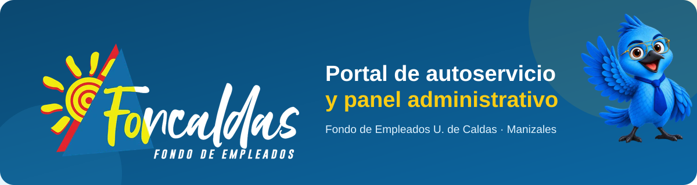

<div align="center">



<br>


**Portal web de FONCALDAS, el Fondo de Empleados de la Universidad de Caldas (Manizales):**
trámites, PQRS y transparencia para los asociados, y un panel para gestionarlos con trazabilidad completa.

<br>


</div>

---

## Resumen

El proyecto tiene dos partes:

- **Sitio público y portal del asociado:** información institucional, servicios, eventos, transparencia, radicación y consulta de trámites y PQRS, sin necesidad de crear cuenta.
- **Panel administrativo:** gestión de solicitudes, PQRS, documentos, eventos, usuarios y tipos de trámite, con trazabilidad completa.

Desarrollado en el marco de la práctica profesional en el área de Tecnologías de la Información.

## Contenido

1. [Funcionalidades](#funcionalidades)
2. [Roles y permisos](#roles-y-permisos)
3. [Flujos principales](#flujos-principales)
4. [Seguridad](#seguridad)
5. [Experiencia de usuario y rendimiento](#experiencia-de-usuario-y-rendimiento)
6. [Stack tecnológico](#stack-tecnológico)
7. [Instalación](#instalación)
8. [Configuración del correo](#configuración-del-correo)
9. [Calidad del código y pruebas](#calidad-del-código-y-pruebas)
10. [Estructura del proyecto](#estructura-del-proyecto)
11. [Puesta en producción](#puesta-en-producción)
12. [Información de la práctica](#información-de-la-práctica)

## Funcionalidades

### Sitio público

| Sección | Qué incluye |
|---|---|
| **Inicio** | Presentación, accesos a los servicios y próximos eventos |
| **Servicios** | Ahorro, Créditos (con líneas de crédito y Créditos Express), Bienestar y Convenios |
| **Afiliaciones** | Quién puede ser socio, cómo asociarse paso a paso, formulario de vinculación en PDF y beneficios |
| **Institucional** | Misión y visión, junta directiva, comités, planta de personal y organigrama |
| **Eventos** | Actividades programadas con descripción, lugar, fecha, hora y multimedia (imagen o video) |
| **Transparencia** | Documentos PDF por categoría (gobierno corporativo, normativa, seguridad de la información, informes, comunicados) con filtros |
| **Trámites** | Radicación de solicitudes y consulta de su estado |
| **PQRS** | Radicación y consulta de peticiones, quejas, reclamos y sugerencias |
| **Contacto** | Datos de contacto, mapa, horario de atención con indicador de abierto/cerrado y canales de WhatsApp por área |
| **Términos y condiciones** | Tratamiento de datos personales |

### Portal del asociado (sin cuenta)

- **Radicar una solicitud** eligiendo el tipo de trámite, con datos de contacto, descripción y documentos de soporte opcionales (PDF, imágenes, Word y Excel, hasta 10 MB cada uno).
- **Código de radicación** único (por ejemplo `FC-26-XXXXXX`) que se entrega en pantalla y por correo.
- **Consultar el estado** con el código y el número de documento: estado actual, historial, documentos publicados por FONCALDAS y posibilidad de adjuntar más archivos mientras la solicitud siga abierta.
- **Descarga segura de documentos** mediante enlaces firmados con caducidad.
- **Notificaciones por correo** en cada cambio de estado y cuando FONCALDAS publica un documento o certificado.
- **PQRS** con autorización de tratamiento de datos, código de seguimiento, consulta de estado y respuesta por correo.

### Panel administrativo

| Módulo | Qué permite |
|---|---|
| **Panel (dashboard)** | Solicitudes pendientes, totales, últimos 30 días, tiempo promedio de resolución y distribución por estado y por tipo de trámite |
| **Solicitudes** | Listado con filtros por estado, tipo de trámite y fechas (con paginación); detalle con datos del asociado, documentos e historial; verificar identidad, aprobar, rechazar con justificación (también sin verificar, cuando los datos no coinciden), finalizar, reasignar responsable y publicar documentos o certificados con versionado. El administrador principal puede eliminar solicitudes del panel (borrado lógico: el historial y los archivos se conservan) |
| **PQRS** *(administrador principal)* | Listado con filtros, detalle, marcar en trámite, responder al asociado por correo y eliminar del panel (borrado lógico) |
| **Documentos** | Subir, editar, reemplazar y eliminar los PDF de transparencia |
| **Eventos** | Crear, editar y eliminar eventos con imagen o video |
| **Auditoría** | Registro de todas las acciones sobre las **solicitudes**, con filtros por código y por usuario; los registros se archivan, no se borran, y se conservan aunque la solicitud se elimine del panel. Las PQRS no tienen historial de acciones: guardan quién respondió y cuándo |
| **Usuarios** *(administrador principal)* | Crear, editar, activar y desactivar funcionarios y asignarles los tipos de trámite que gestionan |
| **Tipos de trámite** *(administrador principal)* | Crear, editar, activar, desactivar y eliminar los tipos disponibles en el formulario público |

## Roles y permisos

- **Administrador principal:** acceso total a todos los módulos y trámites. Recibe todas las notificaciones y no se puede desactivar. Siempre debe existir al menos uno activo.
- **Funcionario:** ve y gestiona únicamente los tipos de trámite que tiene asignados. Recibe por correo solo los avisos de esos tipos. No tiene acceso a las PQRS.
- **PQRS:** las ve, tramita y responde únicamente el administrador principal, que es también quien recibe el aviso de cada PQRS nueva.

Los permisos por tipo de trámite se aplican con políticas de autorización en cada acción, no solo ocultando botones.

## Flujos principales

**Solicitud de un asociado**

1. El asociado radica la solicitud y recibe su código por pantalla y correo.
2. El sistema la **asigna automáticamente** al funcionario activo del tipo de trámite con menos solicitudes abiertas (el administrador principal solo si nadie más atiende ese tipo).
3. Se envía un aviso por correo al funcionario responsable y a los administradores principales.
4. El funcionario **verifica la identidad** frente a la información de asociados y luego **aprueba** o **rechaza** (con justificación); al terminar una aprobada, la **finaliza**. Si los datos no coinciden, la **rechaza sin verificar** y así queda en la auditoría.
5. Puede **publicar un documento o certificado** para el asociado, con versiones.
6. En cada paso el asociado recibe un correo y todo queda registrado en el historial.

**Estados de una solicitud:** Recibida → En revisión → Aprobada → Finalizada. Rechazada es un estado final y se alcanza desde Recibida (identidad no coincide) o desde En revisión.
**Estados de una PQRS:** Recibida → En trámite → Respondida.

**Tipos de trámite iniciales:** Créditos, Ahorro, Bienestar, Convenios, Certificación de afiliación, Certificación de aportes, Retiro de aportes y Otro. Se administran desde el panel.

## Seguridad

- Autenticación de funcionarios con sesión, regeneración de sesión al iniciar y límites de intentos por IP y por cuenta.
- Autorización con políticas y middleware por rol y por tipo de trámite.
- Documentos de las solicitudes en almacenamiento **privado**, servidos solo mediante rutas autorizadas o URL firmadas y siempre como descarga.
- Validación de archivos por su contenido real; la extensión guardada no depende del nombre enviado por el usuario. No se aceptan SVG ni formatos ejecutables.
- Cabeceras de seguridad HTTP (`nosniff`, anti-iframe, política de referrer, permisos del navegador, política de contenido básica y HSTS en producción).
- Protección CSRF, validación de entradas en todos los formularios y límites de tamaño de texto.
- Contraseñas con hash; sin consultas SQL construidas con datos del usuario.
- Límite de correos por destinatario (10 por hora) en los formularios públicos de trámites y PQRS, para evitar abusos.
- Auditoría de cada acción sobre las solicitudes; los registros se archivan en lugar de eliminarse, y las solicitudes y PQRS se eliminan con borrado lógico.
- Dependencias de PHP y de JavaScript sin avisos de seguridad conocidos al momento de la última revisión.

## Experiencia de usuario y rendimiento

- Diseño **responsive** para celular, tablet y escritorio, con modo claro y oscuro.
- Barra de navegación adaptable, con menú de cuenta desplegable para los funcionarios.
- Pantalla de carga con indicador al enviar formularios, que además evita envíos duplicados.
- Navegación casi instantánea: las páginas se precargan al pasar el mouse sobre un enlace.
- Tipografías servidas desde el propio sitio (sin depender de servicios externos).
- Confirmación antes de las acciones que cambian el estado o eliminan información.
- Formularios con etiquetas asociadas, errores junto a cada campo y textos de ayuda.
- Botón flotante de WhatsApp con los canales por área (créditos, afiliaciones y bienestar).

## Stack tecnológico

| Capa | Tecnología |
|---|---|
| Backend | PHP 8.4+ con **Laravel 13** |
| Base de datos | SQLite (archivo `database/database.sqlite`) |
| Vistas | Blade con componentes reutilizables |
| Estilos | Tailwind CSS 4 |
| Interactividad | Alpine.js |
| Compilación de assets | Vite |
| Correo | SMTP (configurable) |
| Pruebas | Pest |
| Calidad de código | Laravel Pint y Larastan (PHPStan) |

## Instalación

Requisitos: **PHP 8.4 o superior** (las dependencias bloqueadas en `composer.lock`, como Symfony 8, no instalan con PHP 8.3) con las extensiones habituales de Laravel, Composer y Node.js.

```bash
git clone <url-del-repositorio>
cd foncaldas

composer install
npm install

cp .env.example .env
php artisan key:generate

php artisan migrate --seed
php artisan storage:link

npm run build      # o `npm run dev` durante el desarrollo
php artisan serve
```

El sitio queda disponible en `http://127.0.0.1:8000`. En Windows con Laravel Herd basta con tener el proyecto en la carpeta de sitios y abrir el dominio `.test` correspondiente.

**Datos iniciales:** el *seeder* crea los tipos de trámite y, si en el `.env` se definen `ADMIN_USERNAME` y `ADMIN_PASSWORD_HASH`, el usuario administrador principal. Define también `ADMIN_EMAIL` con un correo real: el administrador principal recibe todos los avisos y, sin esa variable, queda con un correo `@foncaldas.local` que no recibe nada.

**Idioma:** la aplicación usa `APP_LOCALE=es`; los mensajes de validación están en `lang/es/`.

**Comandos útiles:** `composer run dev` levanta servidor, cola y compilación de assets a la vez.

## Configuración del correo

> **Importante para FONCALDAS:** durante el desarrollo los correos salieron desde una cuenta personal del practicante. Esa cuenta **no** forma parte de la entrega. Antes de usar el sistema en producción, FONCALDAS debe configurar su propia cuenta de correo institucional siguiendo los pasos de esta sección; si no lo hace, el sistema no enviará avisos (o los enviará desde una cuenta ajena).

La aplicación envía estos correos:

| Correo | Quién lo recibe |
|---|---|
| Solicitud radicada / cambio de estado | El asociado que la radicó |
| Nueva solicitud o solicitud reasignada | El funcionario encargado y los administradores principales |
| PQRS radicada | Los administradores principales |
| Avances y respuesta de una PQRS | La persona que la radicó |

Por defecto los correos solo se escriben en el log (`MAIL_MAILER=log`) y no llega nada. Para enviarlos de verdad, toda la configuración vive en el archivo `.env` del servidor (nunca en el código ni en el repositorio).

### Paso 1. Elegir la cuenta que enviará los correos

Se recomienda una cuenta institucional dedicada, por ejemplo `notificaciones@foncaldas.co`, y no el correo personal de un empleado: así los avisos no dependen de una persona y no se pierden cuando alguien deja la entidad.

### Paso 2. Obtener los datos SMTP de esa cuenta

| Proveedor | `MAIL_HOST` | `MAIL_PORT` | Contraseña |
|---|---|---|---|
| Gmail / Google Workspace | `smtp.gmail.com` | `587` | **Contraseña de aplicación** de 16 caracteres (requiere verificación en dos pasos activada; se crea en *Cuenta de Google → Seguridad → Contraseñas de aplicaciones*). La contraseña normal de la cuenta **no** funciona. |
| Outlook / Microsoft 365 | `smtp.office365.com` | `587` | La de la cuenta (el administrador de Microsoft 365 debe tener habilitado *SMTP AUTH* para ese buzón). |
| Hosting propio (cPanel u otro) | El que indique el proveedor, p. ej. `mail.foncaldas.co` | `587` o `465` | La del buzón. |

### Paso 3. Ponerlos en el `.env`

```env
MAIL_MAILER=smtp
MAIL_HOST=smtp.gmail.com
MAIL_PORT=587
MAIL_USERNAME=notificaciones@foncaldas.co
MAIL_PASSWORD=contraseña-de-aplicacion
MAIL_FROM_ADDRESS=notificaciones@foncaldas.co
MAIL_FROM_NAME="FONCALDAS"
```

- `MAIL_USERNAME` y `MAIL_FROM_ADDRESS` deben ser la **misma** cuenta; Gmail y Microsoft rechazan o marcan como spam los correos enviados "a nombre de" otra dirección.
- Si el puerto es `465`, agrega `MAIL_SCHEME=smtps`.
- Revisa también `ADMIN_EMAIL` (ver *Instalación*): es el correo del administrador principal, que recibe todos los avisos.

### Paso 4. Aplicar y probar

```bash
php artisan config:clear
```

Luego radica una solicitud de prueba desde el sitio público y comprueba que llegue el aviso. Si falla, el motivo queda en `storage/logs/laravel.log` (los errores más comunes son contraseña equivocada o, en Gmail, usar la contraseña normal en vez de la de aplicación).

### Paso 5. Correos de los funcionarios

Cada aviso a un funcionario llega según los tipos de trámite que tenga asignados, así que en *Panel → Usuarios* cada usuario debe tener registrado su correo real.

**Cambiar de cuenta más adelante:** basta con repetir los pasos 2 a 4 con los datos nuevos; no hay que tocar el código.

## Calidad del código y pruebas

```bash
php artisan test                          # pruebas automáticas (Pest)
php vendor/bin/pint --test                # estilo de código
php vendor/bin/phpstan analyse            # análisis estático
composer audit && npm audit               # revisión de dependencias
```

Las pruebas cubren los flujos de solicitudes y PQRS, la autorización por tipo de trámite, la auditoría, las validaciones públicas, el renderizado de las vistas y los controles de seguridad.

## Estructura del proyecto

```
app/
  Http/Controllers/      Controladores públicos y de administración
  Http/Middleware/       Roles y cabeceras de seguridad
  Http/Requests/         Validación de formularios
  Models/                Solicitud, Pqrs, Usuario, Documento, Evento, TramiteTipo...
  Policies/              Autorización por tipo de trámite
  Services/              Lógica de negocio (flujos, notificaciones, archivos, transparencia)
  Mail/                  Correos de aviso
resources/
  views/pages/           Páginas públicas y del panel
  views/components/      Componentes reutilizables de Blade
  views/emails/          Plantillas de correo
  css/, js/              Estilos y scripts (Vite)
database/
  migrations/            Esquema de la base de datos
  seeders/               Datos iniciales
routes/web.php           Rutas
tests/                   Pruebas automáticas
```

## Puesta en producción

Antes de publicar, en el `.env`:

```env
APP_ENV=production
APP_DEBUG=false
APP_URL=https://tu-dominio-real.co
SESSION_SECURE_COOKIE=true
SESSION_ENCRYPT=true
```

Y ejecutar:

```bash
composer install --no-dev --optimize-autoloader
npm run build
php artisan migrate --force
php artisan storage:link
php artisan optimize
```

Además: servir el sitio solo por HTTPS, usar un servicio de correo transaccional o el correo institucional, programar copias de seguridad de la base de datos y de la carpeta `storage/`, y rotar cualquier contraseña que se haya compartido durante el desarrollo.

## Información de la práctica

| Dato | Detalle |
|---|---|
| Entidad | FONCALDAS (Fondo de Empleados U. de Caldas) |
| Área | Tecnologías de la Información |
| Duración | 3 de agosto – 3 de diciembre de 2026 |
| Profesor asesor | Marcelo Herrera |
| Responsable en FONCALDAS | Germán Darío Correa Galvis (Representante Legal) |

## Licencia

Uso interno para FONCALDAS.
